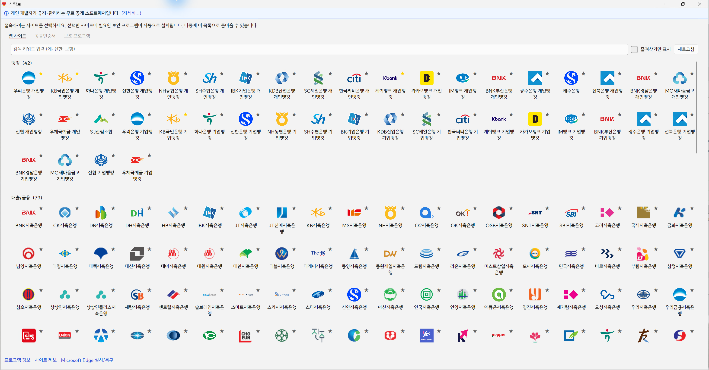

# TableCloth Quick Start Guide

As of October 30, 2026, this guide covers the stable [TableCloth v1.22.0 release](https://github.com/yourtablecloth/TableCloth/releases/tag/v1.22.0). On Windows, TableCloth launches Windows Sandbox and Spork prepares the websites inside it. On an Apple Silicon Mac, macSandbox can launch the no-install `.wsb` configuration to run Spork inside a Windows virtual machine.

The guide covers operating system and hardware requirements, installation, launch, and the first visible result. You do not need to build the source, install a development SDK, or set up TableCloth AI to follow these steps. [한국어 안내](QUICK_START.ko.md)

Start with the environment requirements. Windows users can follow the next two sections; Mac users can continue to [Install and launch on macOS](#install-and-launch-on-macos). Both paths end at [Verify the first result and end the session](#verify-the-first-result-and-end-the-session).

## Choose a supported environment

For the Windows installation, use **Windows 11 Pro, Education, or Enterprise**, an x64 or ARM64 processor, and an internet connection. Windows Home does not provide Windows Sandbox. Microsoft also documents Sandbox on Windows 10, but this guide follows TableCloth's Windows 11 support baseline. See the [Windows Sandbox edition requirements](https://learn.microsoft.com/en-us/windows/security/application-security/application-isolation/windows-sandbox/).

Check **Settings > System > About** for the edition and system type. Check **Task Manager > Performance > CPU** for the virtualization status. The following hardware requirements come from Microsoft's [Sandbox installation guide](https://learn.microsoft.com/en-us/windows/security/application-security/application-isolation/windows-sandbox/windows-sandbox-install).

| Component | Minimum | Additional capacity |
| --- | --- | --- |
| Architecture | x64, or ARM64 on Windows 11 22H2 or later | Match the TableCloth installer to the host architecture |
| Virtualization | Enabled in BIOS/UEFI | A Windows guest also needs nested virtualization from its host |
| Memory | 4 GB RAM | Microsoft recommends 8 GB |
| Processor | 2 CPU cores | Microsoft recommends 4 cores with hyper-threading |
| Storage | 1 GB free for Windows Sandbox | Allow additional space for TableCloth, downloads, and site software; an SSD is preferable |

Also allow administrator approval to enable Windows features and network access to GitHub, the [TableCloth catalog](https://catalog.yourtablecloth.app/), and the selected site's download servers. Organization policies can restrict those operations. Mac hardware and image requirements appear in the macOS section below.

## Enable and check Windows Sandbox

Prepare Windows Sandbox before installing TableCloth. This separates a Windows virtualization problem from a TableCloth setup problem. Follow Microsoft's [installation procedure](https://learn.microsoft.com/en-us/windows/security/application-security/application-isolation/windows-sandbox/windows-sandbox-install).

1. If virtualization is disabled, enable it in the computer's BIOS/UEFI and start Windows again.
2. Search the Start menu for **Turn Windows features on or off**. Select **Windows Sandbox**, select **OK**, and restart if requested.
3. Open **Windows Sandbox** from Start. Wait for a separate Windows desktop to appear.
4. Close that test sandbox and confirm deletion before continuing with TableCloth.

For a command-line alternative to step 2, run the following in **PowerShell as Administrator**, then restart if requested.

```powershell
Enable-WindowsOptionalFeature -Online -FeatureName "Containers-DisposableClientVM" -All
```

If the feature is missing or the standalone sandbox cannot start, resolve the edition, virtualization, or policy condition before continuing. Installing TableCloth does not add Sandbox support to Windows Home.

## Install and launch on Windows

Use the official [GitHub Releases](https://github.com/yourtablecloth/TableCloth/releases/latest) or the WinGet package `TableClothProject.TableCloth`. With WinGet available, install from a terminal using this command.

```powershell
winget install --exact --id TableClothProject.TableCloth
```

If WinGet is unavailable or has not received the latest version, download the installer from GitHub Releases and run it. For v1.22.0, use `TableCloth_1.22.0.0_Release_x64.exe` on an Intel/AMD x64 PC or `TableCloth_1.22.0.0_Release_arm64.exe` on an ARM64 PC. Install the **TableCloth** host package; Spork will run inside the sandbox.

1. Open **TableCloth** from Start. Review and accept the license with **I Agree**, then review and accept the usage notice when it appears.
2. For a first check without certificates, open **Options... > Certificate**, clear **Share joint certificate (NPKI) folder with the sandbox**, and select **Close**. The setting saves automatically. Normal launches otherwise share an existing NPKI folder by default.
3. On **Quick Start**, leave the input empty and select **Start**. If asked to create the data folder, approve creation. The default is `TableCloth\Data` under the host's Windows Documents folder. Check its actual location in **Options... > Data Directory > Current path**.
4. Wait for Windows Sandbox and the Spork **Websites** catalog. Continue with the first-result checks below.

The normal launch maps the data folder with write access. Files saved there remain on the host after the sandbox closes. The [Quick Start implementation](../src/TableCloth.App/ViewModels/QuickStartPageViewModel.cs) defines the launch and folder handling.

Alternatively, after enabling Windows Sandbox, download the official [`no-install-spork.wsb`](https://github.com/yourtablecloth/TableCloth/releases/latest/download/no-install-spork.wsb) and double-click it. The guest downloads SporkBootstrap and Spork without installing TableCloth on the host. This configuration maps no host folders, so host certificate files and the normal data folder are unavailable. See the [no-install configuration](../tools/no-install/no-install-spork.wsb).

## Install and launch on macOS

Use [macSandbox for Windows](https://github.com/yourtablecloth/macSandbox) on an **Apple Silicon Mac, M1 or later**. Its current [README](https://github.com/yourtablecloth/macSandbox/blob/main/README.md) identifies **macOS Tahoe 26 or later** as the validated environment and estimates about **24 GB of free disk space** for the initial baseline. Intel Macs are unsupported. macOS 14 and 15 are build targets whose HVF operation has not been validated.

1. Download the `.dmg` from the [official macSandbox releases](https://github.com/yourtablecloth/macSandbox/releases/latest). Open it and drag **macSandbox for Windows** to **Applications**. If macOS blocks the first launch, check the official download source and use **System Settings > Privacy & Security > Open Anyway** for this app, as described by [Apple](https://support.apple.com/en-us/102445).
2. Download a **Windows 11 ARM64 ISO** from [Microsoft](https://www.microsoft.com/en-us/software-download/windows11arm64). macSandbox does not include Windows or a Windows license and does not download this ISO automatically. Prepare a Windows license that covers your virtual-machine use.
3. Open macSandbox. Select **Choose ISO…**, choose the downloaded ISO, and select **Windows 11 Pro** under **Edition to install**. Select **Build Baseline**, review the license checklist, and start the build after accepting it. The app downloads the drivers and prepares Windows, its account, and the remote desktop connection. The [macSandbox help](https://yourtablecloth.app/macSandbox/help/) estimates 20 to 40 minutes for the first build.
4. When the baseline is ready and a blank Windows session opens, select **Sandbox > Stop Sandbox**. Keep the baseline image; it is reused for later launches.
5. Download TableCloth's official [`no-install-spork.wsb`](https://github.com/yourtablecloth/TableCloth/releases/latest/download/no-install-spork.wsb). In Finder, open it with **macSandbox for Windows**. If double-clicking does not select that app, use **Open With** and choose it. Open the file while no sandbox session is running.
6. Wait for the Windows guest, the setup download window, SporkBootstrap, and finally the Spork **Websites** catalog. Continue with the first-result checks below.

This path runs Spork in macSandbox's Windows guest. It does not install the Windows TableCloth host application on macOS or require Windows Sandbox inside the guest. The `.wsb` uses networking and a logon command, which macSandbox lists as supported in its [compatibility reference](https://github.com/yourtablecloth/macSandbox/blob/main/WSB-SUPPORT.md). This guide describes that documented integration; it does not record an end-to-end run on a Mac.

The default no-install configuration does not map Mac folders or certificate files. macSandbox also has different isolation and device behavior from Windows Sandbox, including no enforcement of mapped-folder `ReadOnly` and no `ProtectedClient` support. Account for those differences if you later customize a `.wsb` file.

## Verify the first result and end the session

Use the same checks in either Windows guest. The [Spork window](../src/Spork.App/MainWindow.axaml) displays site cards; the [site-selection handler](../src/Spork.App/ViewModels/MainWindowViewModel.cs) starts installation when you select a card.

1. Confirm that Spork shows a populated **Websites** catalog. Use its search box to find an institution or site.
2. Select one site's card. If **You may not be in a Windows Sandbox environment** appears, confirm that Spork is inside the Windows guest you prepared and select **OK**. Then review any compatibility notice and wait for the software installation. There is no separate Start button after selecting a card.
3. Confirm **Done** in the installation window or the green installed check on the card, together with the site's official address in the guest browser. The successful installation window closes automatically. A browser opening by itself does not establish that installation succeeded.
4. Stop at the public landing page for this first check. Login, certificates, payments, and completion of a banking or government procedure are outside this check.
5. Save any required results outside the disposable guest before ending it. On Windows, close Windows Sandbox and confirm deletion. On macOS, select **Sandbox > Stop Sandbox**.

At this point, you have observed the catalog, the selected site's software setup, and its page inside the guest. The screenshot below helps identify the Spork screen.



Guest changes disappear when the session ends. The Windows host's writable data folder remains; the no-install path provides no such shared folder. On macOS, the baseline remains until you explicitly destroy it, while the session changes are discarded. See [Windows Sandbox lifecycle](https://learn.microsoft.com/en-us/windows/security/application-security/application-isolation/windows-sandbox/) and [macSandbox session management](https://yourtablecloth.app/macSandbox/help/).

## Resolve a failure at the stage where it occurs

Use the observed stage to narrow the next check. Microsoft's [Sandbox FAQ](https://learn.microsoft.com/en-us/windows/security/application-security/application-isolation/windows-sandbox/windows-sandbox-faq) and the [macSandbox help](https://yourtablecloth.app/macSandbox/help/) cover the underlying runtimes.

- **Windows Sandbox is missing or will not open:** Check the Windows edition, BIOS/UEFI virtualization, administrator approval, and nested virtualization when Windows itself is a VM. A failure before TableCloth opens also affects the prerequisite test.
- **TableCloth rejects the data folder:** Open **Options... > Data Directory > Select Folder...**, choose a writable folder on a local fixed disk, and try **Start** again. Network and removable-drive paths cannot serve as the normal launch's data folder.
- **Spork does not appear after opening a `.wsb`:** Check the guest's network access to GitHub. In the no-install path, leave a failed setup window open and record its error message.
- **The catalog stays empty or site software fails:** Check guest access to the catalog and the site's installer servers. Record the site name and installation error. Do not count an opened browser as a completed software installation.
- **A `.wsb` opens no new Mac session:** Stop the current session and reopen the file with macSandbox for Windows. Baseline build errors belong to the macSandbox setup stage.
- **Normal Windows launch causes a host stop error:** The Quick Start link **Having trouble starting the sandbox?** offers Safe Mode without host folder mappings. Follow the [Safe Mode guide](SAFE_MODE.md) for its limits and a comparison procedure.

For a TableCloth report, include the OS version and edition, CPU architecture, TableCloth or Spork version, chosen launch path, and failure stage in [GitHub Issues](https://github.com/yourtablecloth/TableCloth/issues). Share error text with personal information removed.

## First-run checklist

Use the [release downloads](https://github.com/yourtablecloth/TableCloth/releases/latest) and the checks above to record your first run.

1. Confirm the supported OS, architecture, virtualization, storage, and network conditions.
2. Complete either the Windows Sandbox prerequisite check or the macSandbox baseline build.
3. Install TableCloth on Windows or open the official no-install `.wsb` with the prepared runtime.
4. Confirm the Spork catalog, the selected site's installation status, and its official page in the guest browser.
5. Preserve required output and end the disposable session.

## What the first run establishes

TableCloth prepares a website environment inside a disposable Windows guest. The checks above establish that setup and site opening worked for the selected environment and site. They do not establish that every site's authentication or transaction flow will work.

For subsequent use, choose the Windows host application when you need its folder and certificate options. Choose the no-install `.wsb` path for a guest without those host mappings. Keep runtime compatibility separate from site-specific installation and authentication questions; the [TableCloth support channels](../README.md#사이트-정보-수정과-문제-제보) accept the recorded conditions for further investigation.
